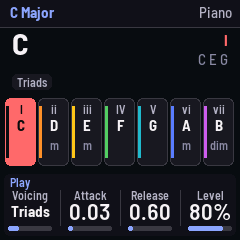
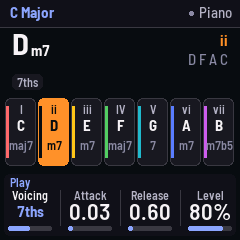
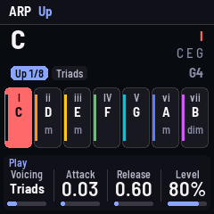

# CHORDS for the M-VAVE FM-1

Custom firmware that turns the FM-1 into your **Chord Generator** web app. Pick a scale and a root:
the white keys play the scale's chords (I, ii, iii… on up the keyboard), the black keys play its
notes. Same twelve synth sounds, same voicings (dyads to 11ths), HOLD, the arpeggiator, the bass and
the whole effects chain, running on the FM-1 itself.

It is built on [FoMni](https://github.com/charlesvestal/fm1-fomni)'s copy of the community FM-1
platform ([Felucca](https://github.com/hugelton/Felucca) by way of
[X0X](https://github.com/charlesvestal/fm1-x0x)): the hardware layer, USB, storage, safe mode and the
installer are theirs, unchanged. The instrument and the UI are new.

> **Status: not yet run on a real FM-1.** It builds and passes every test in the simulator (the
> whole app, UI and sound, on a computer) and in the browser emulator, but the device build and a
> hardware test are still to do. See "Safety" before installing.

  

## From the web app to the FM-1

| Web app | FM-1 |
| --- | --- |
| Chord pads (I, ii, iii…) | **White keys**: one chord per key, 16 of them, so the scale repeats an octave up |
| NOTES tab | **Black keys**: the scale's notes, an octave above the chords. **REC** swaps the rows |
| HOLD button | **PLAY** (lit while on) |
| Arpeggiator mode | **ARP** turns it on and off; mode, rate, tempo and gate on the **Arp** page (SEQ) |
| — | Arp mode **Melody**: the chord plays, with a generated phrase over it; the **Melody** page (EDIT from Arp) sets it |
| Scale / Root / Instrument | **SELECT** / **ALGORITHM** / **PRESETS** encoders |
| Octave | **OCT− / OCT+** |
| Voicing, ATK, REL | **Play** page (HOME), knobs 1–3 (knob 4: level) |
| Bass mode / tone / volume | **Bass** page (EDIT from HOME, twice) |
| Reverb, Delay, Chorus, Tremolo | **Effects** page (FX) |
| Low-pass, High-pass, Auto-filter, Vibrato | **Filter** page (SEL) |
| Overdrive, Bitcrush, Waveshape, Compressor | **Drive** page (EDIT) |
| — | **Setup** page (GLO): arp octaves, tune, MIDI out, key lights |
| — | **ENV** held with a chord key: one more note |
| — | **LFO** held: chords play single notes (their root); press it twice quickly to lock single notes on (LFO lights), twice again for chords |
| — | **SAVE** saves; it also saves by itself when quiet |

MIDI: notes in (USB or the TRS jack) play the current sound; chords and notes go out on channel 1,
the bass on channel 2.

### The melody generator

Set the Arp mode to **Melody** (Arp page, KNOB 1; ARP then turns it on and off). Holding a chord plays the
chord, and over it, an octave up by default, a phrase of 1, 2 or 4 bars at the arp's rate, repeating. The phrase is
written in scale steps over the chord's root, so it follows your chord changes: on the beats it lands on chord tones,
between them it walks the scale, and it ends on the root. Each bar after the first repeats the first with its end
varied. It keeps its place when you change chords; it starts from the top after you let go of everything.

The **Melody** page: **Density** (how many steps get a note), **Length** (1, 2, 4 bars), **Register** (Low: the
chord's octave; Mid: one up; High: two up), **New** (turn: a new phrase). Changing Density, Length or the Rate keeps
the phrase's character (the same seed); New rolls another. The phrase is saved with your settings.

### What is different

- **The 40 "♪" General MIDI sampled instruments are not included.** In the web app they are
  soundfont samples downloaded from the internet as you pick them; the FM-1 has no connection and far
  too little memory for them. The 12 synthesized sounds are all here, with the web app's settings.
- The reverb is a Dattorro plate (FoMni's) standing in for Tone.js's Freeverb, at a similar size.
- The delay is an 8th note at the Tempo (the web app's was fixed at 120 BPM's 8th) and uses one line
  for both sides, to fit the FM-1's RAM.
- Vibrato bends the oscillators directly instead of going through a delay line (same rate and depth).
- **Organ, Brass and Strings have their own sounds.** In the web app all three were the same detuned
  sawtooths. Here the Organ is drawbars with a percussion, Brass a filter that opens as the note
  speaks (with a scoop into the pitch), Strings soft, dark sawtooths that swell in with a vibrato.
  Brass and Strings keep a minimum attack, whatever ATK is set to.
- **Triangle** is a 4-bit stepped triangle, as on game consoles. A smooth triangle sounds almost like
  the sine on the FM-1's speaker.
- **CPU guard**: if the audio load passes 85 %, CHORDS plays fewer voices at once (down to 4), and
  gives them back when the load drops. With every effect on and 12 Strings voices, the load is about
  1.5× FoMni's heaviest; most settings are well under it.

## Try it first, in the browser

`web/emu/` builds the whole firmware for the browser (the same C code, with sound). The GitHub
build below publishes it, or build it yourself (`web/emu/build.sh`, see the script).

## Build and install

The device build needs JieLi's Linux toolchain and three files from their SDK, which the build
fetches from their servers. The simplest way, from a phone or any computer:

1. Put this folder in a new GitHub repository (it already contains `.github/workflows/build.yml`).
2. In the repository: **Settings › Pages › Source: GitHub Actions**.
3. Push (or **Actions › build › Run workflow**). It builds the firmware, runs the tests, and publishes
   a site with the emulator, the web installer and the `.fwsc` download.
4. Open the site's **Install** page in Chrome or Edge with the FM-1 connected by USB. On Android,
   Chrome with a USB-OTG cable works for Web MIDI.

The version number is in the `VERSION` file: change it with each update so the installer and the
FM-1 show which one you have.

Locally instead: see [BUILDING.md](BUILDING.md) (`./build.sh`, then
`python3 tools/fm1_install.py build/chords.fwsc`).

## Safety

Installing custom firmware is at your own risk. The platform has the community's safety nets:
the installer can put M-VAVE's own firmware back; after two failed starts CHORDS stays in a safe
mode with USB on so the installer can still reach it; holding OCT− and OCT+ for 5 seconds enters
update mode; and `tools/fm1_rescue.sh` / [FM-1-transporter](https://github.com/kurogedelic/FM-1-transporter)
cover the chip's own update mode. M-VAVE's M-UPGRADE also restores stock firmware.

## Tests

`tests/run_tests.sh` runs the platform tests, and the whole app in the simulator:
`tests/scenarios/chords.omni` (keys, chords and their notes, HOLD, ARP timing, bass, layout swap,
scales, roots, saving), `sounds.omni` (every sound and every effect, levels) and `heavy.omni`
(12 voices with all effects, and the CPU guard). Screenshots and audio land in `build/scenarios/`.

## Licence

GPL-3.0-only, as the platform it is built on. See [LICENSING.md](LICENSING.md).
